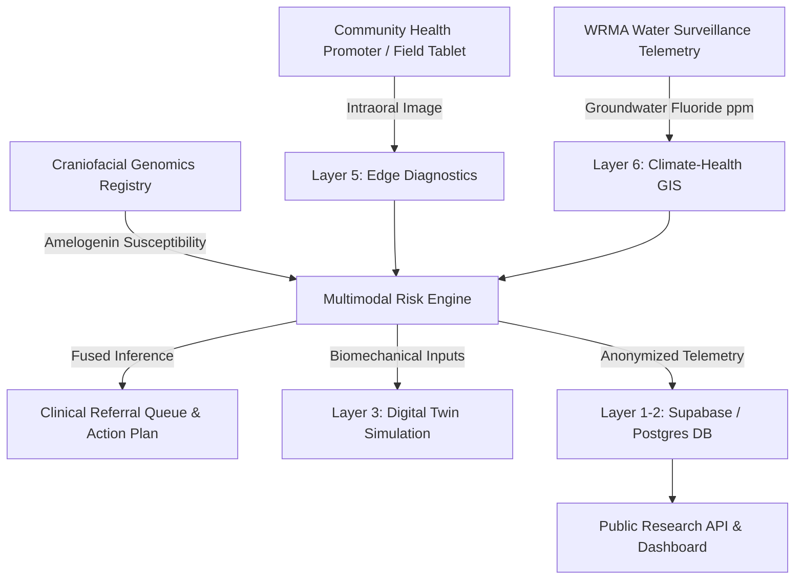

# JinoX AI — Full-Stack Multimodal Health Platform

[](https://github.com/jinox-ai/jinox-fullstack/actions/workflows/ci.yml)
[](https://www.typescriptlang.org/)
[](https://nextjs.org/)
[](https://tailwindcss.com/)
[](https://creativecommons.org/licenses/by-nc-sa/4.0/)

Enterprise-grade, full-stack prototype of the **JinoX AI** platform for the **Google.org Impact Challenge: AI for Science** proposal. Designed for the Kenya pilot, JinoX AI unites intraoral computer vision, environmental groundwater fluoride surveillance, and craniofacial genomics to detect, monitor, and simulate endemic dental fluorosis across the East African Rift Valley.

---

## System Architecture



### Proposal Alignment

| Layer | Module Name | Platform Component | Backed By |
|---|---|---|---|
| **Layer 5** | Low-Resource AI Diagnostics | `ScreeningPanel.tsx` | `POST /api/risk/predict` |
| **Layer 6** | Climate-Health Intelligence | `FluorosisPanel.tsx` | `GET /api/counties`, `GET /api/environment/fluoride` |
| **Layer 3** | Digital Twin Simulation Engine | `TwinPanel.tsx` | Thylstrup-Fejerskov Index (TFI) client engine |
| **Layers 1–2** | Dataset & Foundational Model | `ApiExplorerPanel.tsx` | `GET /api/dataset/summary`, `GET /api/model/performance` |
| **Governance** | Program Milestone Dashboard | `DashboardPanel.tsx` | 18-Month Target Projections (`lib/data.ts`) |

---

## Key Features

- **Hybrid Data Architecture**: The application operates out of the box using calibrated, seeded epidemiological data from Kenya's Rift Valley. When Supabase credentials are provided, it seamlessly switches to live PostgreSQL queries with automatic failover.
- **Multimodal Risk Fusion**: Fuses 45% visual enamel feature extraction, 35% environmental groundwater exposure, and 20% genomic markers, mapped to WHO Dean's Fluorosis Index and the Thylstrup-Fejerskov Index (TFI).
- **Accessible & Responsive UX**: WAI-ARIA compliant tabs, keyboard navigation, full image drag-and-drop / file upload simulation, latency timers, and JSON report export.
- **Production-Grade Security**: Strict input validation, RFC-compliant error responses, CSP/X-Frame-Options security headers, and non-root Docker execution.

---

## Quick Start

### Prerequisites

- Node.js 18.17+ or 20.x
- npm 9+ or pnpm / yarn

### Installation

```bash
# Clone repository
git clone https://github.com/<your-org>/jinox-fullstack.git
cd jinox-fullstack

# Install dependencies
npm install

# Start development server
npm run dev
```

Open [http://localhost:3000](http://localhost:3000) with your browser.

### Quality & Verification Scripts

```bash
# Static type checking
npm run type-check

# ESLint audit
npm run lint

# Production build test
npm run build
```

---

## Environment & Supabase Setup

The application works completely offline or without credentials using seeded data. To enable live persistence:

1. Create a project at [supabase.com](https://supabase.com).
2. Execute the schema migration in the Supabase SQL Editor:
   ```bash
   cat supabase/schema.sql
   ```
3. Create `.env.local` based on `.env.example`:
   ```env
   NEXT_PUBLIC_SUPABASE_URL=https://<your-project-id>.supabase.co
   NEXT_PUBLIC_SUPABASE_ANON_KEY=<your-anon-key>
   SUPABASE_SERVICE_ROLE_KEY=<optional-service-role-key-for-write-audit>
   ```
4. Restart the server. The platform will automatically query Supabase tables and append `X-Data-Source: supabase` to API responses.

---

## Deployment Options

### Option 1: Vercel (Recommended)

[](https://vercel.com/new)

1. Push your code to GitHub.
2. Import the repository in the Vercel Dashboard.
3. Configure `NEXT_PUBLIC_SUPABASE_URL` and `NEXT_PUBLIC_SUPABASE_ANON_KEY` under Project Settings &gt; Environment Variables.
4. Click **Deploy**.

### Option 2: Docker Container

A multi-stage, hardened Dockerfile is included:

```bash
# Build production image
docker build -t jinox-ai:latest .

# Run container on port 3000
docker run -d -p 3000:3000 --name jinox-prototype jinox-ai:latest
```

Open [http://localhost:3000](http://localhost:3000).

---

## API Specification

### `GET /api/counties`
Returns the list of monitored counties, mean fluoride concentrations (ppm), risk classification, and screening rollups.

### `GET /api/environment/fluoride?county={name}`
Returns hydrogeological telemetry for a specific county compared to WHO 1.5 ppm guidelines.

### `GET /api/dataset/summary`
Returns multimodal registry scale (records, modalities, counties covered, and academic license).

### `GET /api/model/performance`
Returns foundational diagnostic model validation metrics (AUC, sensitivity, specificity, fairness subgroup audits).

### `POST /api/risk/predict`
Calculates calibrated multimodal fluorosis risk from demographic, visual, environmental, and genomic signals.

**Request Payload:**
```json
{
  "county": "Nakuru",
  "patientAge": 34,
  "imagingSignal": 72,
  "geneticSignal": 45
}
```

**Response Payload:**
```json
{
  "input": {
    "county": "Nakuru",
    "patient_age": 34,
    "modalities_used": ["imaging", "environmental", "genomic"],
    "timestamp": "2026-09-18T18:30:00.000Z"
  },
  "output": {
    "imaging_signal": 72,
    "environmental_signal": 60,
    "genetic_signal": 45,
    "fused_fluorosis_risk": 62,
    "tier": "mod",
    "recommendation": "Moderate fluorosis risk signal. Recommend dietary fluoride review, water testing, preventive dietary counseling, and follow-up screening within 6 months.",
    "clinical_staging": {
      "deans_index": "Moderate",
      "tfi_score": 5,
      "description": "Pronounced opaque white striations with localized brown staining and micro-pitting."
    }
  }
}
```

---

## Clinical & Ethical Disclaimer

> [!CAUTION]
> **Not for Direct Diagnostic Use**: JinoX AI is a research and clinical decision-support prototype. It is not an approved medical device and does not replace evaluation by a qualified dental surgeon or clinical practitioner.
>
> **Privacy by Design**: No patient Personally Identifiable Information (PII) is stored or transmitted. In the Supabase schema, the `screenings` table has no public read policy, ensuring data captured at community health clinics is safeguarded under Kenyan Data Protection Act (2019) regulations.
