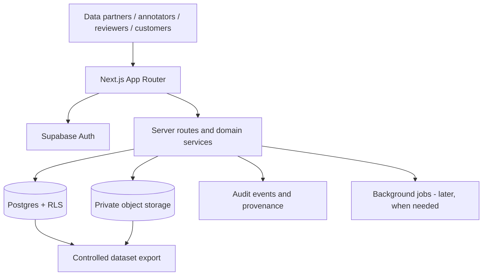

# JinoX AI platform architecture

## Product boundary

JinoX is a research data operations platform for East African oral-health AI. Its primary job is to collect authorized data, curate it, coordinate expert annotation, validate quality, and deliver versioned datasets. It is not a clinical decision-support system and must not present experimental risk outputs as validated clinical advice.

## Recommended stack

- **Web and server runtime:** Next.js App Router + React + TypeScript, deployed on Vercel.
- **Identity and relational data:** Supabase Auth + PostgreSQL with Row Level Security (RLS).
- **Clinical assets:** private Supabase Storage buckets, short-lived signed URLs, checksum and provenance metadata.
- **UI:** Tailwind CSS and accessible, reusable components; introduce a component library only where it reduces duplication.
- **Validation:** shared TypeScript domain types and explicit server-side request validation. Add a schema library such as Zod when dependency and lockfile changes can be tested in CI.
- **Quality:** ESLint, TypeScript strict mode, unit tests for domain rules, integration tests for RLS and API routes, and end-to-end tests for the critical annotation workflow.
- **Delivery:** GitHub pull requests + CI + Vercel preview deployments; production schema changes only through reviewed migrations.

Do not introduce microservices, a separate queue system, vector search, or a model-serving platform until measured workload requires them. A modular monolith is simpler to secure and operate at the current stage.

## Logical architecture



## Domain modules

1. **Identity and access:** user profile, organization membership, project membership, role and permissions.
2. **Data intake:** source, collection authorization, pseudonymous case identifiers, asset metadata, checksums and storage paths.
3. **Dataset registry:** dataset definitions, schema versions, inclusion criteria, lineage and release status.
4. **Annotation operations:** work items, assignments, annotation revisions, reviewer decisions, adjudication and quality metrics.
5. **Governance:** consent/legal-basis metadata, ethics approvals, permitted purposes, retention and withdrawal workflows.
6. **Delivery:** immutable dataset releases, manifests, label dictionaries, quality reports, access agreements and export audit events.
7. **Commercial operations:** customer projects, quotes, task rates, invoices and payment reconciliation; do not mix billing state into clinical labels.

## Required invariants

- All patient-linked records and source assets remain private by default.
- Never authorize using user-editable profile metadata.
- Enforce tenant/project membership in server code and PostgreSQL RLS; UI visibility is not authorization.
- Keep the Supabase service-role key server-only. Never prefix it with `NEXT_PUBLIC_` or use it in browser modules.
- Signed asset URLs are short-lived and issued only after authorization.
- Every dataset item has provenance and a documented lawful basis before it can be released.
- Annotation changes are versioned. Reviews and adjudication are separate from the annotator's own submission.
- Dataset exports are reproducible, versioned, access-controlled, and accompanied by a manifest and limitations.
- Do not call pseudonymized health data anonymous.
- Do not use real patient data in tests, screenshots, fixtures or logs.

## Target repository layout

```text
app/
  (auth)/                 # sign-in and callback routes
  (workspace)/            # authenticated product pages
  api/                    # thin HTTP adapters only
components/
  ui/                     # shared accessible primitives
  features/                # feature-specific presentation
lib/
  config/                  # validated environment configuration
  supabase/                # browser/server clients
  auth/                    # authorization helpers
  domains/
    datasets/
    intake/
    annotations/
    governance/
    delivery/
  shared/                  # errors, ids, dates, logging
supabase/
  migrations/
docs/
  architecture/
tests/
  unit/
  integration/
  e2e/
```

Migrate toward this layout incrementally. Keep route handlers thin: parse and validate input, establish identity and permissions, call a domain function, map domain errors to HTTP responses, and emit an audit event.

## Recommended delivery sequence

1. Make environment and auth handling fail safely.
2. Establish a reliable type-check/lint/build CI gate.
3. Extract shared domain types and validation from route handlers.
4. Implement organization/project membership and role-based authorization consistently.
5. Complete annotation assignments, independent reviews, adjudication and immutable dataset releases.
6. Add tests for cross-project access denial, storage authorization, and consent/withdrawal rules.
7. Add AI pre-labeling only after a human-reviewed baseline and measurable quality criteria exist.
8. Add exports and customer APIs with per-release access grants and audit logs.

## Out of scope until justified

Avoid premature microservices, Kubernetes, a separate data warehouse, autonomous clinical recommendations, and automated labeling without review. Use managed Postgres and object storage first; revisit architecture when actual volume, latency, or isolation requirements demonstrate a need.
