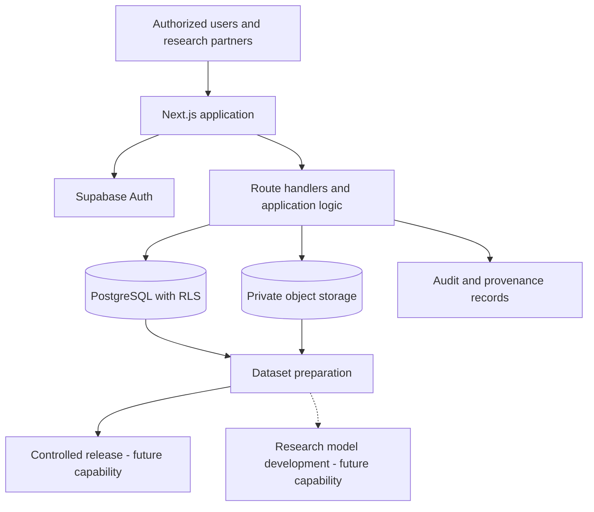

# JinoX AI platform architecture

**Document status:** living architecture guide  
**Product stage:** research-data operations prototype  
**Last reviewed:** 2026-11-04

## 1. Product boundary

JinoX is a research data operations platform for East African oral-health research. Its current engineering purpose is to support project metadata, data intake, case-linked records, dataset preparation, annotation, and controlled access.

It is not a validated clinical decision-support system. The repository does not currently implement a validated multimodal foundation model, autonomous diagnostic inference, individual genomic risk prediction, or a biological digital-twin simulator.

The long-term research vision may include those capabilities. They must remain clearly separated from shipped functionality and require independent scientific validation, governance, safety review, and regulatory assessment.

## 2. Current implementation

The following describes the codebase, not a guarantee that every deployment has the required migrations or environment configured.

| Domain | Present in repository | Not yet complete / operationally verified |
| --- | --- | --- |
| Application shell | Next.js App Router pages and global navigation | Full browser-based regression coverage |
| Identity | Supabase Auth integration and profile/access-level workflows | Production identity lifecycle and credential verification |
| Research projects | Project metadata, membership, and related API/database structures | Full institutional governance and approval workflow |
| Dataset registry | Dataset metadata and dataset-item structures | Immutable releases, manifest generation, and governed exports |
| Intake | Case metadata, supported asset upload, private storage paths, structured record import | Server-side content inspection, malware scanning, and robust de-identification |
| Annotation | Dataset-item queue and annotation revision records | Complete reviewer UI, disagreement resolution, adjudication, and quality reporting |
| Environmental data | Source-attributed water/climate measurement capture | Validated environmental epidemiology and county risk inference |
| Clinical assessments | Manual assessment documentation | Diagnostic inference or clinical decision support |
| Genetics | Research protocol metadata | Raw genomic intake, analysis, and individual risk prediction |
| Case records | Case-linked assets and longitudinal observations | 3D reconstruction or biological simulation |
| Training preparation | Dataset/annotation readiness information | Training execution, experiment orchestration, model registry, and deployment |

The standalone Research page was retired from primary navigation. Research API route groups remain present; their existence must not be interpreted as proof that a complete user-facing research workflow is available.

## 3. Technology stack

- **Web application:** Next.js App Router, React, TypeScript
- **Presentation:** Tailwind CSS and reusable accessible components
- **Authentication:** Supabase Auth
- **Relational data:** Supabase PostgreSQL with Row Level Security
- **Object storage:** private Supabase Storage buckets and short-lived signed URLs
- **Hosting:** Vercel
- **Source control and CI:** GitHub and GitHub Actions

The current architecture is a modular monolith. Prefer clear domain boundaries within the existing application before considering microservices, separate queues, vector infrastructure, or dedicated model-serving systems.

## 4. Logical architecture



The dashed model path is a future research direction, not an implemented training or inference pipeline.

## 5. Domain boundaries

1. **Identity and access:** authenticated identity, profile, project membership, access level, and permission checks.
2. **Project management:** research purpose, project metadata, membership, and project-level scope.
3. **Data intake:** pseudonymous case references, source metadata, file validation, asset registration, and provenance.
4. **Dataset registry:** dataset definitions, modality, inclusion criteria, item linkage, and lifecycle status.
5. **Annotation operations:** work items, assignment boundaries, annotation revisions, review, adjudication, and quality measures.
6. **Governance:** ethics determination, consent or other lawful basis, permitted purpose, retention, withdrawal, and sharing constraints.
7. **Delivery:** immutable releases, manifests, label dictionaries, quality reports, access grants, and export audit events.
8. **Research extensions:** environmental analysis, genetics research metadata, model development, and simulation; these remain distinct from validated clinical functionality.

## 6. Security invariants

- Patient-linked records and source assets remain private by default.
- UI visibility is not authorization. Verify identity, role, project membership, and object access on the server and in RLS.
- Never authorize using user-editable profile metadata.
- Keep service-role credentials server-only; never expose them through browser modules or `NEXT_PUBLIC_*` variables.
- Issue short-lived signed URLs only after authorization. Treat them as bearer credentials.
- Preserve provenance and annotation revisions.
- Independent review must not be performed by the original annotator.
- Dataset export must be permissioned, reproducible, versioned, and auditable before being enabled for real data.
- Pseudonymized health data must not be described as anonymous without a defensible formal determination.
- Do not place real patient data, tokens, signed URLs, or source files in tests, screenshots, analytics, or logs.

See [data governance](data-governance.md), [annotation assignment and access](annotation-assignment-access.md), and [research authorization testing](../testing/research-authorization.md).

## 7. Repository structure

```text
app/                  Next.js pages, layouts, and route handlers
components/           Shared and feature UI
lib/                  Supabase clients, validation, and shared application logic
supabase/migrations/  Ordered schema, policy, and function migrations
tests/unit/           Unit tests
tests/integration/    Staging-oriented integration tests
docs/                 Architecture, governance, and testing documentation
planning.md           Milestones and delivery strategy
tasks.md              Prioritized implementation backlog
```

The repository may not yet match every idealized domain boundary. Refactor incrementally; do not perform broad structural moves without tests and a migration plan.

## 8. Engineering standards

### Application boundaries

- Keep route handlers thin: parse input, authenticate, authorize, validate, call domain logic, and map errors to stable HTTP responses.
- Centralize validation and domain rules rather than duplicating them across pages and APIs.
- Keep browser and server Supabase clients separate.
- Use explicit TypeScript types for persisted domain records and API payloads.
- Do not trust client-provided user IDs, ownership fields, role names, file paths, or status transitions.

### Database changes

- Every schema change must be a timestamped migration committed to source control.
- Review RLS policies, grants, triggers, and security-definer functions as part of the migration.
- Apply migrations first to a dedicated staging project and verify expected behavior.
- Never treat a migration file in GitHub as proof that the remote Supabase project has applied it.
- Include rollback or forward-recovery notes for changes that affect persisted data.

### Errors and observability

- Return safe, actionable errors to users; do not expose SQL, stack traces, tokens, signed URLs, or sensitive record existence.
- Keep logs structured and minimized.
- Record security-relevant events without embedding patient content.
- Define monitoring, alert ownership, incident triage, and retention before production use.

### Testing

- Unit-test validation and domain rules.
- Integration-test authentication, RLS, project isolation, storage access, and permission boundaries with separate synthetic users.
- Add end-to-end coverage for critical workflows: sign-in, intake, dataset creation, annotation, review, and export.
- Test loading, empty, error, permission-denied, expired-session, and network-failure states.
- A skipped integration suite is not a passing authorization assessment.

### Dependency and release management

- Keep `package.json` and `package-lock.json` synchronized.
- Prefer reproducible clean installs in CI after lockfile consistency has been established.
- Review security advisories and breaking changes before dependency upgrades.
- Require CI and preview deployment checks before merging.
- Record migration and deployment requirements in each release PR.

## 9. Delivery sequence

See [planning.md](../../planning.md) for milestone definitions and [tasks.md](../../tasks.md) for the current actionable backlog. The intended order is:

1. Security, dependency, and deployment baseline.
2. Reliable data intake and project-scoped access.
3. Complete annotation assignment, independent review, and adjudication.
4. Dataset quality, provenance, versioning, and controlled release.
5. Research interoperability and reproducible model-preparation workflows.
6. Future scientific AI capabilities, only after appropriate evidence and governance.

## 10. Architecture decision rules

- Prefer the smallest implementation that satisfies a documented user and security requirement.
- Do not introduce infrastructure for speculative scale.
- Do not combine major framework upgrades, schema redesigns, and domain refactors in one change.
- Do not silently change API contracts or persisted data semantics.
- Treat clinical, genomic, and other sensitive data processing as high-risk changes requiring explicit review.
- Keep product copy aligned with shipped behavior.

## 11. Change control

Update this guide when a material change affects the application architecture, data boundaries, authorization model, deployment topology, or operational responsibilities. Each significant architecture change should record its context, decision, alternatives considered, consequences, and migration plan in an architecture decision record (ADR) or an equivalent pull-request description.
